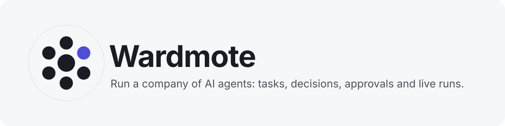
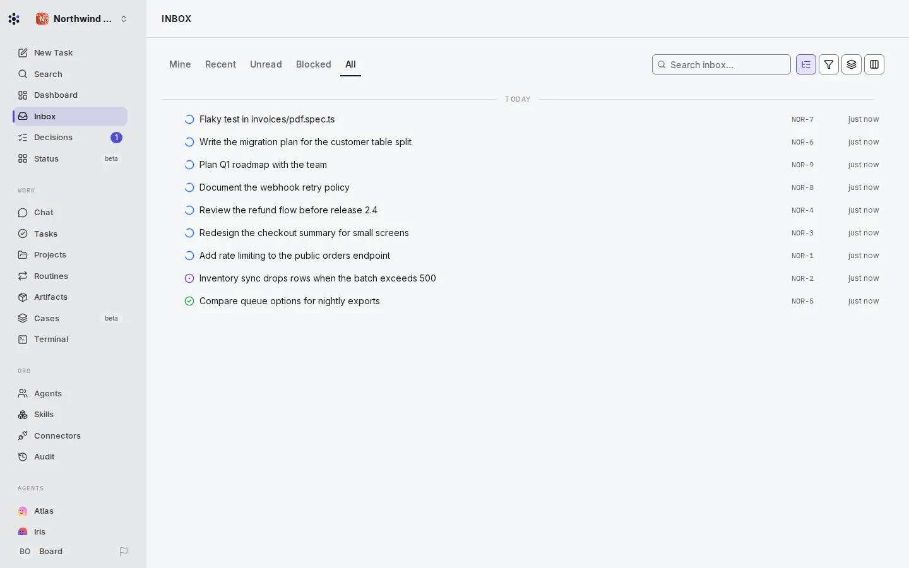
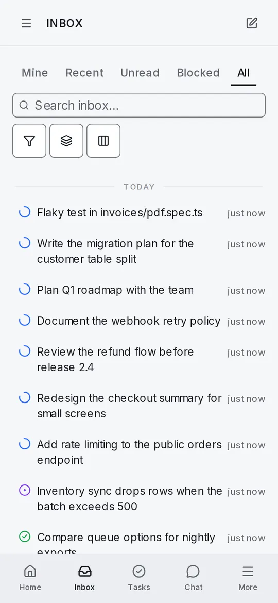
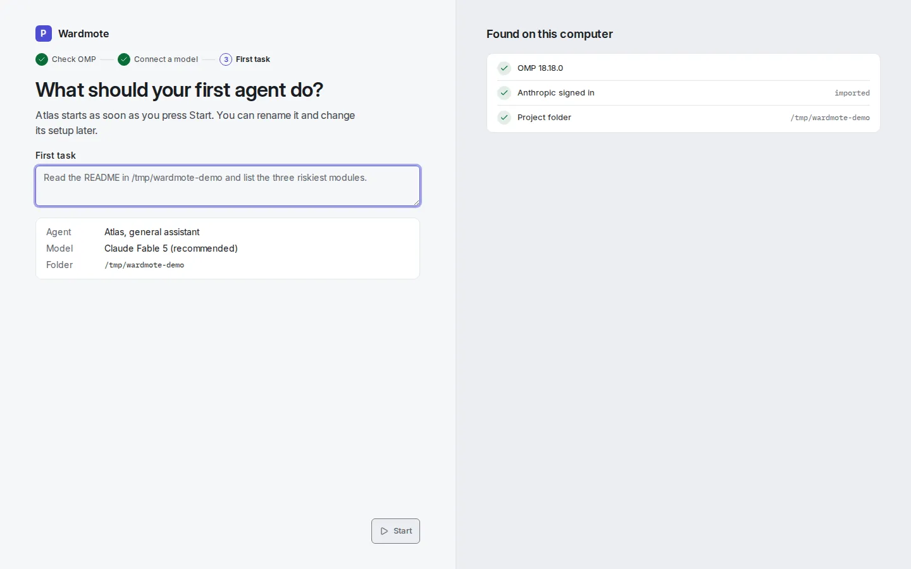
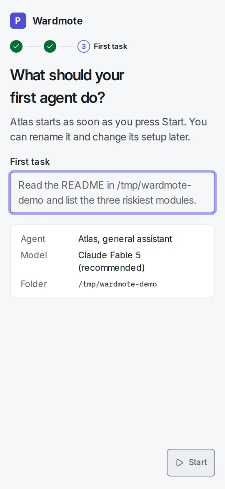
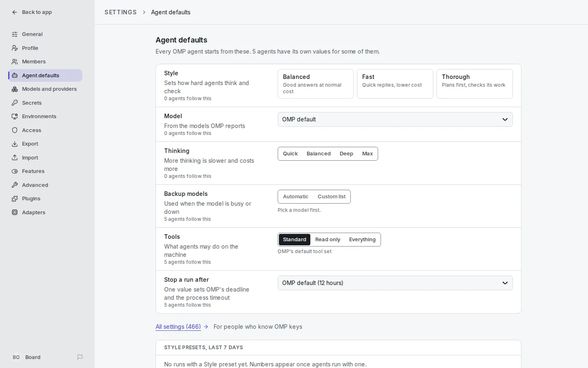
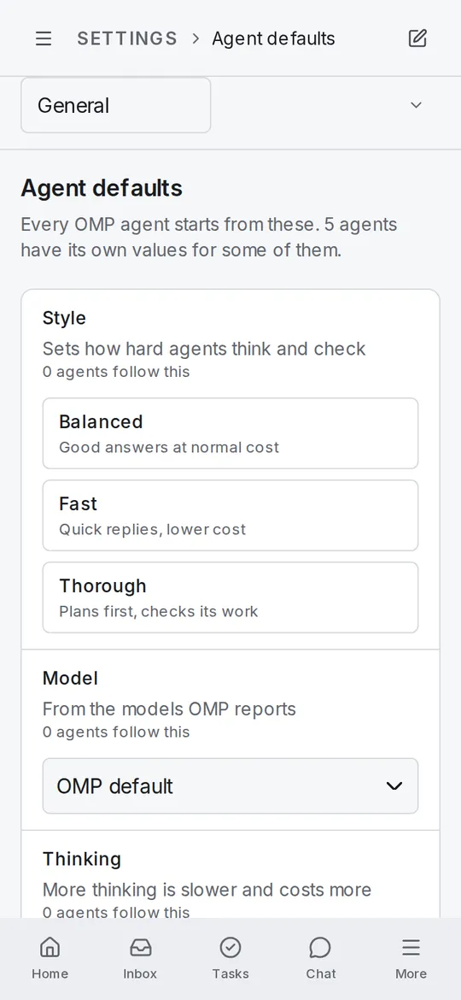
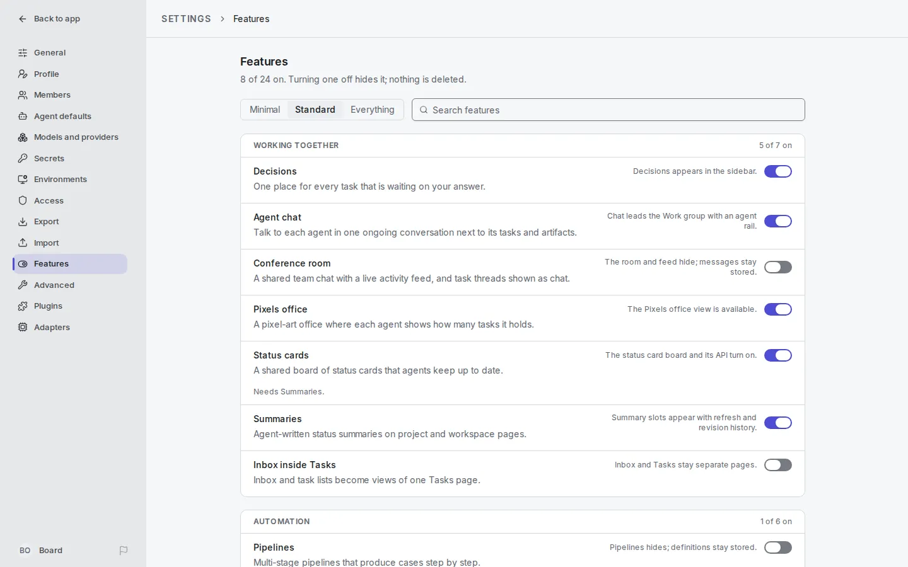
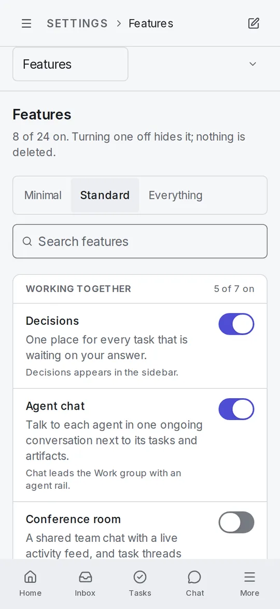
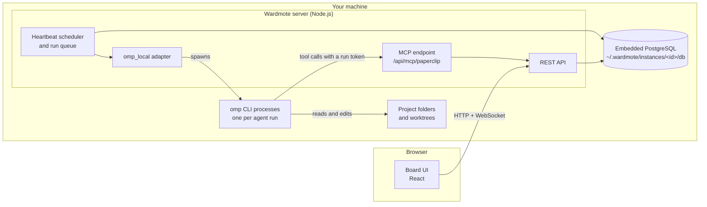

<p align="center">
  <picture>
    <source media="(prefers-color-scheme: dark)" srcset="docs/assets/readme/banner-dark.svg">
    
  </picture>
</p>

<p align="center">
  <a href="https://www.npmjs.com/package/@tickernelz/wardmote"></a>
  <a href="https://github.com/tickernelz/wardmote/actions/workflows/ci.yml"></a>
  <a href="LICENSE"></a>
  
</p>

Wardmote is a self-hosted control plane that runs a team of AI coding agents as a company: an org chart, tasks and decisions, approvals, scheduled heartbeats, budgets and an audit trail. One Node.js server holds an embedded PostgreSQL and serves a React board, and every agent is a local [Oh My Pi (OMP)](https://github.com/can1357/oh-my-pi) process that reports back through Wardmote's own MCP endpoint.

## Why Wardmote

- **One install, nothing else to run.** `npx @tickernelz/wardmote@latest install --yes` puts a verified, versioned payload in your home directory. PostgreSQL is embedded; there is no Docker, no external database and no cloud account.
- **Agents that work like staff.** Each agent has a role, a manager, a task queue and a budget. Work moves through tasks, decisions and approvals that you see in one inbox, on a phone or a desktop.
- **OMP-first.** The `omp_local` adapter is built in. Onboarding finds OMP on the machine, lists the models it reports and creates the first agent; Agent defaults sets OMP behaviour for every agent at once.
- **Safe to operate.** Updates back up the database first and roll back on a failed health check. Service restarts drain or adopt live agent runs instead of killing them.

## Screenshots

Light and dark follow your GitHub theme. All screenshots come from a throwaway instance with demo data.

<table>
<tr><th>Desktop (1440 px)</th><th>Phone (360 px)</th></tr>
<tr><td colspan="2"><b>Inbox:</b> every task, decision and blocker that needs you</td></tr>
<tr>
<td><picture><source media="(prefers-color-scheme: dark)" srcset="docs/assets/readme/inbox-desktop-dark.webp"></picture></td>
<td><picture><source media="(prefers-color-scheme: dark)" srcset="docs/assets/readme/inbox-phone-dark.webp"></picture></td>
</tr>
<tr><td colspan="2"><b>Onboarding:</b> finds OMP, picks a model and a project folder</td></tr>
<tr>
<td><picture><source media="(prefers-color-scheme: dark)" srcset="docs/assets/readme/onboarding-desktop-dark.webp"></picture></td>
<td><picture><source media="(prefers-color-scheme: dark)" srcset="docs/assets/readme/onboarding-phone-dark.webp"></picture></td>
</tr>
<tr><td colspan="2"><b>Agent defaults:</b> OMP settings shared by every agent</td></tr>
<tr>
<td><picture><source media="(prefers-color-scheme: dark)" srcset="docs/assets/readme/agent-defaults-desktop-dark.webp"></picture></td>
<td><picture><source media="(prefers-color-scheme: dark)" srcset="docs/assets/readme/agent-defaults-phone-dark.webp"></picture></td>
</tr>
<tr><td colspan="2"><b>Features:</b> turn product areas on or off without losing data</td></tr>
<tr>
<td><picture><source media="(prefers-color-scheme: dark)" srcset="docs/assets/readme/features-desktop-dark.webp"></picture></td>
<td><picture><source media="(prefers-color-scheme: dark)" srcset="docs/assets/readme/features-phone-dark.webp"></picture></td>
</tr>
</table>

## Quick start

Requirements: Node.js 24.11 or newer with `npm`, on Linux, macOS or WSL2, and [OMP](https://github.com/can1357/oh-my-pi) 18.1.16 or newer for the agents. The published packages ship prebuilt.

```sh
npx @tickernelz/wardmote@latest install --yes
export PATH="$HOME/.local/bin:$PATH"
wardmote onboard --yes
```

`install` resolves one exact version (the `latest` dist-tag, or `--version`), checks that all 20 packages of that release are on npm before it downloads anything, installs them into `~/.wardmote/cli/installs/npm/<version>`, smoke-tests the payload, and only then flips `~/.wardmote/cli/current` and writes the `~/.local/bin/wardmote` shim. In an interactive bash or zsh session it offers to add `~/.local/bin` to `PATH` for you; otherwise it prints the `export` line above.

`onboard --yes` writes `~/.wardmote/instances/default/config.json` for trusted local loopback and starts the server on `http://127.0.0.1:3100`. Open it and the onboarding page walks you through OMP, the model and the project folder. For an instance other machines can reach, choose a bind preset:

```sh
wardmote onboard --yes --bind lan
wardmote onboard --yes --bind tailnet
```

The current release is [`2026.1108.1`](https://github.com/tickernelz/wardmote/releases/tag/v2026.1108.1). Pin a version with `wardmote install --version 2026.1108.1 --yes`.

### Coming from Paperclip Pro

`@tickernelz/paperclip-pro` is deprecated and receives no further releases; install `@tickernelz/wardmote` instead. The CLI also answers to `paperclip-pro` for this release. An existing `~/.paperclip-pro` home keeps working; `wardmote migrate-home` moves it to `~/.wardmote` after you stop the service. Details: [doc/RELEASE-NOTES-wardmote-rename.md](doc/RELEASE-NOTES-wardmote-rename.md).

## Features and Advanced

Settings → **Features** lists 24 product areas in five groups. Each has a plain-language summary and says what changes when it is on or off; turning one off hides it and deletes nothing. The Minimal, Standard and Everything presets set the whole list at once.

| Group | Features |
| --- | --- |
| Working together | Decisions, Agent chat, Conference room, Pixels office, Status cards, Summaries, Inbox inside Tasks |
| Automation | Pipelines, Cases, Plan breakdown history, Plan before first task, Built-in agents, Fast replies |
| Integrations | Chat channels, Memory connectors, Assistant connections, GitHub review bots, OpenAI Dot, Linked objects, Beta skills |
| Workspaces | Environments, Isolated workspaces |
| Display | Goals in sidebar, Plain-English cards |

Settings → **Advanced** holds the switches for people who run or develop Wardmote itself:

| Group | Settings |
| --- | --- |
| Developer | Developer mode, Server info, Restart dev server when idle, Smoke lab |
| Runtime | Native runner, Managed environments only, Sandbox duplex bridge, Worktree run execution, Branch reconcile forward, Dirty workspace repair, Owner is instance admin |

The catalog lives in [`packages/shared/src/feature-catalog.ts`](packages/shared/src/feature-catalog.ts).

## Configuring OMP

**For every agent.** Settings → **Agent defaults** sets Style (Balanced, Fast, Thorough), Model, Thinking, Backup models, Tools and the run time limit for every OMP agent, and shows how many agents follow each value. **All settings** opens every OMP setting that the installed OMP version reports.

**For one agent.** An agent's configuration page overrides any of those values for that agent alone; Agent defaults counts the agents that have their own values. A single task can also run on a different model or thinking level than its assignee, and pass that choice on to its subtasks.

**For many agents.** Select agents in the Agents list to change their model or thinking level in one atomic call: one invalid value rejects the whole batch and writes nothing.

## Architecture



- **Server**: Express 5 serves the API, the built board UI and the MCP endpoint on one port (3100 by default).
- **Embedded PostgreSQL**: created on first start under the instance directory and migrated with Drizzle; database backups run hourly by default into `data/backups`.
- **Board UI**: React 19, installable as a PWA, laid out for both phone and desktop.
- **`omp_local` adapter**: starts one `omp` process per agent run, streams its transcript to the board and caps how many local runs start at once, because OMP is memory-hungry while it boots.
- **MCP**: agents reach Wardmote through `POST /api/mcp/paperclip` with a run-scoped token. The tools are generated from the OpenAPI document; the default `core` toolset gives an agent 67 tools, and `?toolsets=core,extended` gives 483. Each tool carries an `agent` or `board` authority, so a `ceo` agent sees more than an engineer.

## Operations

Instance state lives under `~/.wardmote/instances/<id>/`: `config.json`, `service.env`, the database, logs, storage, secrets and backups. An install or update only writes under `~/.wardmote/cli/` and the shim; instance data survives switching payloads in either direction.

```sh
wardmote service install
wardmote service status
wardmote service logs
wardmote service restart --drain
```

`restart` keeps live agent runs by default; `--drain` stops admitting new runs and waits for the live ones first. On Linux the systemd user unit is `paperclip-pro.service` for the `default` instance.

```sh
wardmote update --check
wardmote update --latest
wardmote update --rollback
```

`update` backs up the database, installs the new payload, restarts the service and validates it; a failed validation rolls back automatically. `--rollback` returns to the previous payload; it does not reverse database migrations. `wardmote doctor` checks the setup, and `wardmote configure` edits the instance config.

Operator environment such as `PATH` entries for adapter binaries, API keys and proxies goes in `service.env`, one `KEY=value` per line; the CLI never rewrites it.

| Variable | Default | Meaning |
| --- | --- | --- |
| `WARDMOTE_HOME` | `~/.wardmote` | Root of all instance state |
| `WARDMOTE_INSTANCE_ID` | `default` | Instance under `WARDMOTE_HOME/instances/` |
| `PORT` | `3100` | HTTP port, overrides `server.port` |
| `WARDMOTE_MAX_CONCURRENT_LOCAL_RUNS` | `20` | Local agent runs allowed at once (also under Settings → General) |
| `WARDMOTE_MAX_CONCURRENT_LOCAL_STARTS` | `4` | Local runs allowed in their startup phase at once |
| `WARDMOTE_LOCAL_START_WAIT_BYPASS_SEC` | `120` | A queued run that waited this long starts past the startup cap |
| `WARDMOTE_RUN_OOM_SCORE_ADJ` | `500` | Linux `oom_score_adj` for run processes, so the kernel kills runs before the server |
| `WARDMOTE_TELEMETRY_DISABLED=1` or `DO_NOT_TRACK=1` | unset | Turns off anonymous usage telemetry (already off under CI) |

The older `PAPERCLIP_*` spellings still work in this release and log a deprecation warning. Day-two operation, backups, public hostnames and release mechanics are in [docs/fork/OPERATIONS.md](docs/fork/OPERATIONS.md); observability (OpenTelemetry, Sentry) is in [doc/observability.md](doc/observability.md).

## Development

Node 24.18.0 and pnpm 9.15.4 (`packageManager` in `package.json`). Work in a git worktree per change and never point a development instance at `~/.wardmote`.

```sh
git clone https://github.com/tickernelz/wardmote.git
cd wardmote
pnpm install --frozen-lockfile
pnpm dev
```

| Command | What it does |
| --- | --- |
| `pnpm dev` | API and UI in watch mode on `:3100` |
| `pnpm build` | Builds every package |
| `pnpm typecheck` | Type-checks every package |
| `pnpm test` | Vitest, the default gate |
| `pnpm test:e2e` | Playwright browser suite |
| `pnpm db:generate` / `pnpm db:migrate` | Drizzle migrations |

The native runner builds from Rust source when enabled; install a Rust toolchain for it. Tests and manual trials must never touch a live instance; [doc/DEVELOPING.md](doc/DEVELOPING.md) shows how to run one on its own data directory.

More in [doc/DEVELOPING.md](doc/DEVELOPING.md), [doc/INSTALLING.md](doc/INSTALLING.md) and the CLI reference [doc/CLI.md](doc/CLI.md). Bugs go to [this repository's issues](https://github.com/tickernelz/wardmote/issues).

## Releases

Pushing a `v<YYYY.MDD.P>` tag runs [`.github/workflows/release.yml`](.github/workflows/release.yml): it refuses a tagged commit that is not on `main` or has no green CI run, builds once, publishes the package set under the `next` dist-tag in dependency order, moves `latest` once npm serves all of it, and opens a [GitHub release](https://github.com/tickernelz/wardmote/releases). `scripts/tag-release.sh` picks the next free version and checks the same conditions before it pushes the tag.

```sh
./scripts/tag-release.sh --dry-run
./scripts/tag-release.sh
```

## Licence and attribution

MIT, see [LICENSE](LICENSE). Wardmote is a **hard fork** of [paperclipai/paperclip](https://github.com/paperclipai/paperclip), branched at upstream commit `7b7c4d417` and developed separately since. Upstream work is copyright Paperclip AI; the fork's changes are copyright Zhafron Adani Kautsar. Both notices are in [LICENSE](LICENSE). Wardmote is not an upstream release and is not endorsed by the upstream authors, so please file Wardmote bugs here, not upstream.
